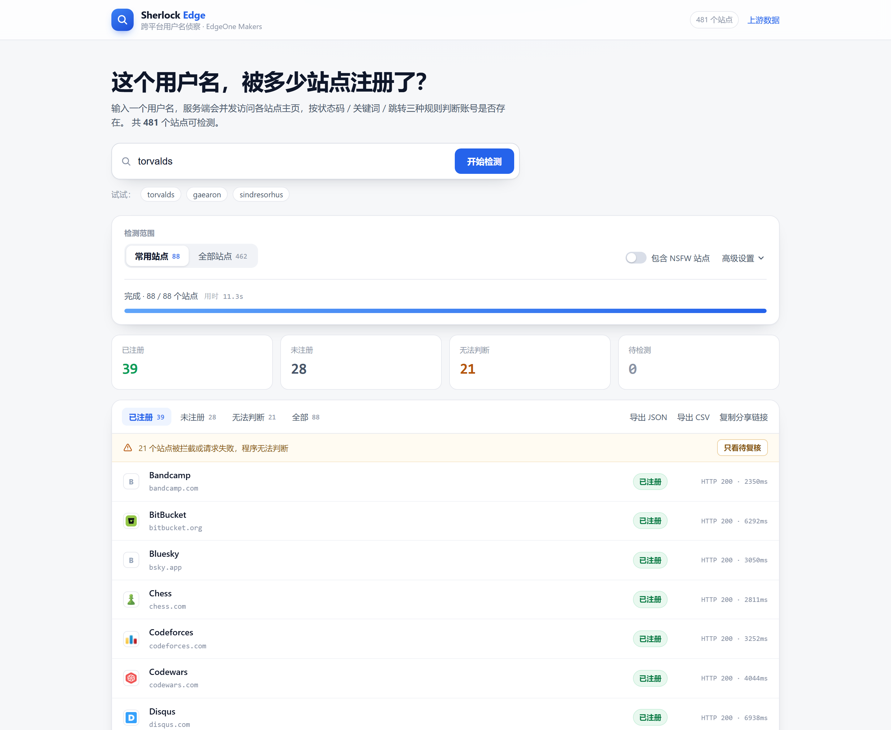
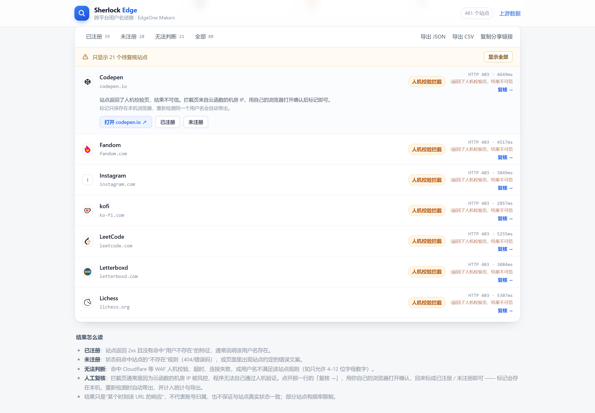

# Sherlock Edge · 部署在 EdgeOne Makers 上的用户名侦察

把 [sherlock-project/sherlock](https://github.com/sherlock-project/sherlock) 这个 Python CLI 工具，改造成一个可以直接部署在 **EdgeOne Makers（原 EdgeOne Pages）** 上的 Web 应用：



- 前端是一个静态页面（用户名输入 + 实时结果表）；
- 后端是 EdgeOne 的 **Cloud Functions（Node.js）**，把 Sherlock 的判定逻辑用 TypeScript/JavaScript 重写，在服务端并发访问各站点；
- 站点清单直接复用上游的 `data.json`，构建时生成精简数据集；
- 被 WAF 拦截的站点不会硬猜，标成「无法判断」并支持**人工复核**（见下文）。

```
浏览器                         EdgeOne Makers
┌──────────────────┐   /api/sites   ┌──────────────────────────┐
│ index.html       │ ─────────────► │ cloud-functions/api/     │
│ assets/app.js    │   /api/check   │   sites.js  → data/*.json│
│ 分批 + 并发调度   │ ─────────────► │   check.js  → lib/engine │
│ 实时进度 / 导出   │ ◄───────────── │     ├ 并发 fetch 各站点   │
└──────────────────┘   JSON 结果     │     └ 状态码/关键词/跳转  │
                                    └──────────────────────────┘
```

原项目是「一个进程跑完 480 个站点」；Serverless 函数有执行时长上限，所以改成了**客户端分批 + 服务端小并发**：首批 6 个站点先探路（约 4 秒出第一屏结果），其余每批 16 个，浏览器同时发 6 批，单次函数调用最多 24 个站点、内部并发 8。

---

## 目录结构

```
sherlock-edgeone/
├─ index.html                    # 页面
├─ assets/
│  ├─ app.js                     # 分批调度、进度、结果渲染、导出
│  └─ style.css
├─ cloud-functions/api/
│  ├─ sites.js                   # GET /api/sites   返回站点清单
│  └─ check.js                   # GET/POST /api/check 探测一批站点
├─ lib/
│  ├─ engine.mjs                 # ★ Sherlock 判定逻辑（状态码/关键词/跳转/WAF）
│  └─ sites.mjs                  # 站点数据加载与缓存
├─ data/
│  ├─ sites.json                 # 构建产物（精简数据集，64 KB）
│  └─ sherlock-source.json       # 上游 data.json 快照（保证离线可构建）
├─ scripts/
│  ├─ build-data.mjs             # 数据编译：上游 JSON → sites.json
│  └─ test-engine.mjs            # 引擎冒烟测试
├─ server/dev.mjs                # 本地预览服务（模拟静态资源 + 函数路由）
├─ edgeone.json                  # 构建/函数/缓存头配置
└─ package.json
```

---

## 本地预览

```bash
cd sherlock-edgeone
npm run preview        # http://localhost:8787
```

不需要登录、不需要安装依赖（零 runtime 依赖），这个脚本会同时提供静态页面和两个 API 路由。

想验证判定逻辑本身：

```bash
npm test               # 默认探测 torvalds，断言 GitHub 判定为 claimed
node scripts/test-engine.mjs <username>
```

---

## 部署到 EdgeOne Makers

### 方式一：Git 仓库导入（推荐）

1. 把 `sherlock-edgeone/` 推到 GitHub / GitLab / Gitee 等仓库。
2. 打开 [EdgeOne Makers 控制台](https://console.tencentcloud.com/edgeone/makers) → 新建项目 → 导入 Git 仓库。
3. 构建设置（仓库根目录即 `sherlock-edgeone/`）：

   | 配置项 | 值 |
   | --- | --- |
   | 框架预设 | 其他 / 静态站点 |
   | 安装命令 | `npm install`（无依赖，可留空） |
   | 构建命令 | `node scripts/build-data.mjs` |
   | 输出目录 | 默认（项目根目录） |
   | Node 版本 | 22.x |

   这些值大部分已写进 `edgeone.json`，控制台按仓库配置走即可。
4. 部署完成后访问分配的域名，`/api/sites` 能返回 JSON 就说明函数已生效。

### 方式二：CLI 直接上传

```bash
npm install -g edgeone
edgeone login                       # 或 edgeone login -t <API Token>

cd sherlock-edgeone
edgeone makers deploy . -n sherlock-edge -e production
```

> 部署时 `cloud-functions/`、`data/`、`index.html` 必须一起在根目录；`edgeone.json` 已声明 `cloudFunctions.nodejs.includeFiles = ["data/sites.json"]`，保证函数能读到站点数据。

### 官方本地调试（可选）

```bash
edgeone makers dev      # 需先 edgeone login，默认端口 8088
```

`edgeone makers dev` 会同时托管静态资源和函数；本项目没有配置 `devCommand`，因此它不会去启动别的前端 dev server。若不方便登录，用上面的 `npm run preview` 即可，行为等价。

---

## 关键参数

| 位置 | 参数 | 默认 | 说明 |
| --- | --- | --- | --- |
| `assets/app.js` | `BATCH_SIZE` | 16 | 每个函数调用探测的站点数 |
| 页面「高级设置」 | 单站点超时 | 9000 ms | 目标站点慢/被墙时会等这么久 |
| 页面「高级设置」 | 服务端并发 | 8 | 单次函数调用内的并发 fetch 数 |
| 页面「高级设置」 | 浏览器并发批次 | 6 | 同时在飞的函数调用数 |
| `lib/engine.mjs` | `maxSitesPerRequest` | 24 | 接口硬上限 |
| `edgeone.json` | `maxDuration` | 30 s | Cloud Functions 单次执行上限（可调到 60/120） |

约束关系：`24 / 8 × 9s ≈ 18s`，留足在 30s 以内。如果把批量调大或超时调长，记得同步提高 `maxDuration`。

---

## API

### `GET /api/sites`

```json
{ "count": 481, "popular": 88, "generatedAt": "...",
  "sites": [{ "n": "GitHub", "m": "https://www.github.com/", "k": 1, "x": 0 }] }
```

`k=1` 常用站点，`x=1` NSFW。

### `GET /api/check?u=<用户名>&s=<站点名,逗号分隔>&t=<超时ms>&c=<并发>`

也支持 `POST /api/check`，body 为 `{"username":"torvalds","sites":["GitHub","Reddit"]}`。

```json
{ "username": "torvalds", "took": 3201, "count": 2,
  "results": [
    { "name": "GitHub", "home": "https://github.com/", "url": "https://github.com/torvalds",
      "status": "claimed", "http": 200, "ms": 2103 },
    { "name": "Reddit", "home": "https://reddit.com/", "url": "https://reddit.com/user/torvalds",
      "status": "error", "http": 403, "ms": 1802, "note": "HTTP 403，疑似反爬拦截" }
  ] }
```

`status`：`claimed` 已注册 / `available` 未注册 / `illegal` 用户名不合法 / `waf` 人机校验 / `error` 请求失败。

---

## 判定逻辑对照

`lib/engine.mjs` 逐条对应上游 `sherlock_project/sherlock.py` 的 `query_username` + 结果判定段：

| 上游 | 本实现 |
| --- | --- |
| `regexCheck` 不通过 → `ILLEGAL` | `compileRegex()`，并兼容 Python 的 `(?i)`、`\Z`、`\A` 写法 |
| `errorType = status_code` | 命中 `errorCode`、或状态码不在 2xx → 未注册 |
| `errorType = message` | 在响应正文里找 `errorMsg`（字符串或数组），找不到 → 已注册 |
| `errorType = response_url` | `redirect: 'manual'`，2xx → 已注册 |
| `status_code` 用 HEAD，其它用 GET | 相同，另外 HEAD 遇 405/403/501 会自动回退 GET |
| `urlProbe` / `request_payload` 插值 | 相同的递归 `{}` 替换，POST 时自动补 `Content-Type: application/json` |
| WAF 指纹 → `WAF` | 保留 Cloudflare / AWS WAF / PerimeterX 特征，另加几条常见 CDN 特征 |
| 请求异常 → `UNKNOWN` | 记录 `error` + `note`（超时 / 连接失败） |

**刻意增强的三处**（都是为了避免误报"已注册"）：

1. `errorType = message` 且状态码是 401/403/406/418/419/429/5xx、正文又没命中"不存在"特征时，判为 `error` 而不是 `claimed` —— 数据中心 IP 很容易被反爬拦截，此时"没找到错误文案"并不代表账号存在。
2. `status_code` 遇到 429 / 5xx 判 `error`（上游会判为未注册），避免把目标站点自身故障当成"用户名没人用"。
3. 正文最多读 300 KB，超出即截断，防止超大页面拖垮函数内存。

---

## 更新站点数据

```bash
npm run build:data:remote   # 从 GitHub 拉取最新 data.json，更新快照并重新编译
npm run build:data          # 只用本地快照重新编译
```

仓库里已经带了 481 个站点的快照，所以构建时即使访问不了 GitHub 也能正常产出。边缘函数读取 `data/sites.json` 后会在实例内缓存，不会每次调用都读盘。

---

## 拦截页怎么办：人工复核



Cloudflare 的 "Verify you are human"、AWS WAF 的 challenge、PerimeterX 的按压验证，这些都要**真人 + 浏览器环境**才能通过。服务端没法替你过：

- 云函数的出口是机房 IP，本来就在风控名单上；
- 验证挑战依赖 JS 执行、鼠标轨迹、Canvas 指纹，`fetch` 拿不到；
- 用 iframe 把验证页嵌进来也不行，`X-Frame-Options: DENY` / CSP `frame-ancestors` 会直接拒绝，而且拿到了 clearance cookie 也是种在 iframe 的域上，跟服务端请求无关。

所以这里做的是**把判断权交回给人**，而不是假装能自动过验证：

1. 判定为 `waf` / `error` 的行右侧会出现「复核 →」，点开展开一条操作栏；
2. 点「打开 xxx.com ↗」用**你自己的浏览器**访问（家用 IP + 已登录状态，通常直接就能看到真实页面）；
3. 回来点「已注册 / 未注册」，该行立刻变成对应颜色并加一个 `人工` 小标签，同时计入统计与导出；
4. 标记写在 `localStorage`（key `sherlock.reviews.v1`，按用户名分组），刷新或重新检测同一个用户名会自动带出，不会重复劳动；
5. 结果区顶部有一条提示条「N 个站点被拦截…·只看待复核」，点进去可以逐条过，标完一条自动展开下一条；「清除人工标记」可以一键回滚。

导出的 JSON / CSV 里，`auto_status` 是程序判定、`status` 是最终结论、`source` 区分 `auto` / `manual`，人工结论不会被当成程序结论混淆。

> 为什么不做「浏览器端自动重试」：跨域 `fetch(..., {mode:'no-cors'})` 只能拿到 opaque response，读不到状态码和正文；`X-Frame-Options` 也挡住了 iframe 读取。想真正自动化，只能自建带住宅代理 + 无头浏览器的后端，那已经不是 EdgeOne 边缘函数能承担的事了。

---

## 已知限制

- **数据中心 IP 会被拦**：Cloudflare、AWS WAF、PerimeterX 等会给人机校验页，这部分结果会落到「无法判断」，需要走上面的人工复核。部署在中国大陆节点时，Twitter/X、LinkedIn、Reddit 等站点的成功率明显偏低。
- **结果只代表某一时刻**：站点改版、临时 502、频控都会影响判定，工具不保证与真实账号状态一致，也不推断账号归属。
- **单站点 9 秒超时**：慢站点会被记为超时；想更准可以调大超时、同时调小批次并发。
- **NSFW 站点默认隐藏**：页面右上角开关可以放开（19 个）。
- EdgeOne 免费版 Cloud Functions 的函数区域固定，无法就近选择；Pro 及以上可在 `edgeone.json` 的 `mainlandRegions` / `overseasRegions` 指定。

## 许可

判定逻辑与站点数据来自 [sherlock-project/sherlock](https://github.com/sherlock-project/sherlock)（MIT License），本项目同样以 MIT 发布。
